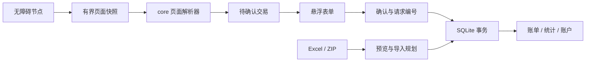

# 架构

## 模块

`core` 使用 Kotlin/JVM，定义整数分金额、交易类型、页面快照、解析器、重复依据、选择规则和导入规划。`app` 将 Android 事件与节点转换为快照，负责界面、数据库和系统交互。两个模块通过交易与目录模型连接。

## Android 结构

| 包或组件 | 职责 |
| --- | --- |
| `accessibility/` | 应用白名单、节点快照、过期任务取消、页面离开与服务解绑 |
| `overlay/` | 系统悬浮窗口、独立生命周期、焦点与返回分发 |
| `ui/` | Compose 页面、表单草稿、导航、筛选和日期组件 |
| `data/` | SQLite 表与迁移、事务、查询、导入导出、选择学习 |
| `LedgerGraph` | 进程状态、IO 调度、候选、权限和通知协同 |
| `LedgerViewModel` | Activity 界面状态与恢复前台入口 |
| `update/` | 公开发行元数据读取、双源结果合并、版本比较与检测状态 |
| `LedgerNotifications` | 通知渠道、固定通知 ID、暂停/继续与快捷录入 |

## 更新检测

更新检测由 MainActivity 前台入口触发，UpdateController 的协程随 LedgerViewModel 清理，网络与有界读取在 IO 执行。24 小时检查间隔和自动检测开关单独保存在本地偏好；账目存储及无障碍服务不依赖网络结果。两个源分别请求，等待结果后按稳定数字版本选择最高版本；公开版本按 core 的 AppVersion 排序；Android 安装构建号通过固定偏移量独立递增，避免公开版本重置影响后续检测。

## 页面解析

微信普通交易优先读取商户名称字段。缺少该字段时，解析器核对金额相邻的商户名称；金额下方的名称需要与紧随其后的状态标签一起出现。名称冲突或字段缺失时等待页面补齐。交易时间、单号与整数分金额分别校验，平台单号继续作为交易身份依据。

## 保存边界

金额采用整数分，余额合计使用整数。确认请求使用 UUID 保证重试幂等；平台交易号与来源快照用于识别可能重复的交易。再次保存相同交易属于新的确认请求。

账单、账户余额、来源凭据和选择学习在同一数据库事务中写入。导入规划先计算映射、重复和冲突，确认后提交事务。账本合并重新检查预览依据，并在事务内迁移引用。数据库工作和文件读写通过 IO 调度执行。

## 通知生命周期

通知状态由功能开关、暂停状态、完整服务连接和通知权限共同计算。状态变化会更新固定通知 ID。Activity 恢复前台时主动核对并发送当前通知，形成通知清除后的恢复入口。关闭通知、关闭自动记账或系统阻止通知时，核对结果会撤下通知。

恢复路径直接读取当前状态，避免依赖相等值的 StateFlow 再次发射。通知权限与渠道状态保持系统语义，前台恢复过程按现有授权显示。

应用内反馈使用带消息编号与级别的 UiNotice。成功消息在操作返回后生成；清除消息时核对编号，防止旧提示结束时清掉新提示。SnackbarVisuals 保存当前消息的语义级别，主题提供对应的容器与文字色。

## 显示与统计

账户与分类均为全局目录，账本只组织账单。分类由稳定 ID、收支类型、名称、图标、组内位置和隐藏状态组成。启用与隐藏两组共享同一套对象，拖动或批量变更在完整目录校验后以事务提交。新增、合并和删除账本保留全局目录。

应用读取界面目录时，为完全空的账户目录建立一个未设置余额的现金账户。新记账表单沿用有效账户，账户选择器只提供真实账户；保存前要求选择账户。导入和历史数据保留原字段含义。

内置分类按 presetKey 与默认名称生成本地化显示文本，存储、导出与导入比较继续使用原始名称和稳定 ID。记账、管理、筛选、统计与明细共用显示规则，用户改名与自定义分类保留原文。

时间快捷范围定义在 core，替换起止边界并保留其他查询条件。趋势图使用分页前计算的日、月 CashFlow 汇总，补齐有界空日期，并将长范围合并为最多 60 段。金额展示保持整数分，绘图阶段才将归一化比例转换为浮点值。图表选择的期间可转回同一个 LedgerQuery 查看明细。

## 数据与版本

应用版本在 `gradle.properties` 中定义。数据库当前为 v9，ZIP 写 v5、读取 v1–v5。分类表直接保存全局对象，ZIP 中分类记录也采用相同模型。`io.github.localledger.app` 及完整无障碍组件属于安装身份约定。

按账本保存的旧分类在升级事务中转为全局对象。相同名称、来源和图标的配置合并，引用同时重映射；不同名称或图标的变体分别保留。每个预置来源保留一个可恢复默认的对象，额外变体作为自定义分类管理。账单金额、时间、版本、账户与来源凭据保留原值，提交前检查外键引用。
